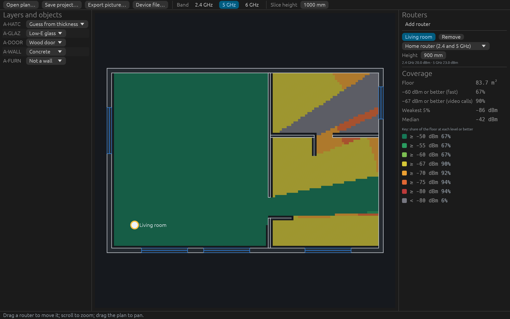

# RadioCraft (beta)

RadioCraft plans Wi-Fi coverage from the floor plans and models you already have. Open a DXF plan
from CADCraft, or an OBJ or STL model exported from SolidCraft. Tell it what each layer or object
is made of, place routers and access points, and see the predicted signal across the floor.



It is a beta. The numbers are a planning estimate from a simple indoor model, not a site survey;
see [What the numbers mean](#what-the-numbers-mean).

## What it does

- **Plans from other Craft apps.** A DXF plan is read by its layers (CADCraft's `A-WALL`,
  `A-GLAZ`, `A-DOOR`, `A-FURN` and the like). A 3D model is cut at a height (1 m by default) and
  read by its objects, one per SolidCraft body. Blocks, arcs, bulged polylines and hatches are
  read; walls drawn as closed outlines keep their rooms open.
- **Materials.** Each layer or object is concrete, drywall, low-E glass, interior glass, metal,
  a wood door, "not a wall", or "guess from thickness" (drywall below 140 mm, concrete from there).
  The first guess comes from the names (`glass`, `door`, `fridge`, `sofa`…); change any of them.
  A custom loss in dB for each band is allowed too.
- **Routers.** Place, drag and remove routers. Each has a height and a device: generic home
  routers, a ceiling access point and a mesh node are built in, and a device file built from FCC
  and ISED certification records adds real products.
- **Coverage.** A heatmap for 2.4, 5 or 6 GHz; the share of the floor at −60 dBm or better (fast)
  and −67 dBm or better (video calls), the weakest 5 % and the median; hover anywhere for the
  signal there and which router gives it.
- **Projects.** Save the materials, routers and settings as a `.rcraft` file beside the plan.
  Export the heatmap as a PNG.
- **Everything is a command.** The window, the CLI and scripts all run the same commands.

## Build and run

Rust 1.90 or later.

```bash
cargo run --release -p radiocraft
```

```bash
cargo run --release -p radiocraft -- tests/fixtures/cadcraft-apartment.dxf
```

The command-line tool runs the same engine without a window:

```bash
cargo run --release -p radiocraft-cli -- plan tests/fixtures/cadcraft-apartment.dxf --router 1200,1200,900 --device generic-router --material A-WALL=concrete --png coverage.png
```

```bash
cargo run --release -p radiocraft-cli -- script docs/examples/cadcraft-apartment.json
```

`radiocraft-cli commands` lists every command and its parameters. A script is
`{"commands": [{"command": "...", "params": {...}}, ...]}`, run in order; the window takes the
same file with `--script` (and `--screenshot out.png` to save a picture of the window and quit).

### From SolidCraft

Export the design as OBJ (File → Export, OBJ). SolidCraft writes one object per body, in
millimetres with Z up, which is what RadioCraft expects. Open the `.obj`; set the slice height in
the top bar if 1 m doesn't cut through the walls. An STL has no object names, so it arrives as one
object; give it a material by hand.

### From CADCraft

Save the plan as DXF. Layer names choose the first materials; anything on a furniture,
dimension or annotation layer is left out.

## Device files

A device file is a JSON list:

```json
[{"id": "u7-pro", "name": "U7 Pro", "eirp_dbm": {"2.4": 25.0, "5": 29.0, "6": 26.5}}]
```

Load it with **Device file…** or `devices.load`. EIRP is the conducted power plus antenna gain,
as the certification records give it; values above the usual regulatory limits (30 dBm at 2.4
and 5 GHz, 27 dBm at 6 GHz) are capped unless `cap_eirp` is turned off.

## What the numbers mean

The signal at a point is

> EIRP − path loss at 1 m − 10 · n · log10(distance) − the loss of each wall on the way

with n = 2.2, the path loss at 1 m from the band's centre frequency, and the distance in 3D
between the router and a device held at 1 m. Each wall is counted once per crossing, exactly, from
the plan's outlines (not from the heatmap's grid), and where two materials overlap the larger loss
counts. Reflections, furniture, people, interference and the client's own radio aren't modelled;
real signal is often a few dB either side. Use it to compare placements, then check on site.

## Status

Beta. Working: DXF and OBJ/STL plans, materials, routers, devices, the three bands, the
heatmap and figures, projects, PNG export, the CLI and scripts. Not yet: several floors, channel
planning, automatic placement, antenna patterns, measured site surveys, translations beyond
English (strings go through `i18n::tr` already). See [docs/plan.md](docs/plan.md).

## Licence

MIT OR Apache-2.0, at your option. Third-party files are listed in
[ATTRIBUTION.md](ATTRIBUTION.md).
